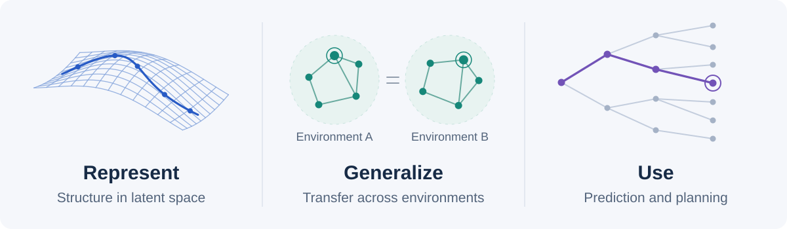

<!-- BEGIN GENERATED RESEARCH MAP -->

# Awesome Generalizable World Models

Papers on how learned world models represent reusable structure, generalize across environments and tasks, and support prediction and planning. Topics include adaptation, interpretability, structured representations, latent geometry, and evaluation.

[Topics](#research-map) · [Reading Guide](docs/reading-guide.md) · [Supplementary Reading](docs/supplementary.md) · [BibTeX](references.bib) · [Contributing](CONTRIBUTING.md)

## Contents

| Topic | Coverage | Papers |
| :--- | :--- | ---: |
| [Generalization & Adaptation](#m3) | Unseen compositions, dynamics shifts, task transfer, and adaptation. | 11 |
| [World Model Interpretability](#m8) | Physical variables, causal interventions, and interpretable model design. | 4 |
| [Structured & Compositional Representations](#m1) | Objects, relations, and modular transition mechanisms. | 4 |
| [Representation Geometry & Symmetry](#m2) | Latent geometry, symmetry priors, and predictive dynamics. | 2 |
| [Planning & Task-Relevant World Models](#m4) | Goal-directed prediction, task abstraction, and model-based action selection. | 6 |
| [Evaluation & Benchmarks](#m5) | Physical extrapolation, compositional tests, and closed-loop evaluation. | 2 |

29 papers across six topics · 9 supplementary papers · 38 papers in total.

The catalog includes methods, theory, and empirical analyses of generalization and its limits. Papers are listed alphabetically within each topic.

## Papers

### Generalization & Adaptation

Unseen compositions, dynamics shifts, task transfer, and adaptation.

- **Behavior-Invariant Task Representation Learning with Transformer-based World Models for Offline Meta-Reinforcement Learning** 
  Fuyuan Qian et al. · **ICML 2026** · [Paper](https://proceedings.mlr.press/v306/qian26o.html) 
  Learns task representations invariant to behavior policy for offline-to-online adaptation.

- **Considering Context: When World Models Need Context Encoders** 
  Oleg Smirnov et al. · **arXiv 2026** · [Paper](https://arxiv.org/abs/2610.06651) 
  Measures the prediction information supplied by context beyond an agent's history.

- **Context and Diversity Matter: The Emergence of In-Context Learning in World Models** 
  Fan Wang et al. · **ICLR 2026** · [Paper](https://proceedings.iclr.cc/paper_files/paper/2026/hash/a46b9dcef23e9160f46d800a49a931d0-Abstract-Conference.html) · [Code](https://github.com/airs-cuhk/airsoul/tree/main/projects/MazeWorld) 
  Distinguishes recognizing familiar environments from learning dynamics through current experience.

- **Context-aware Dynamics Model for Generalization in Model-Based Reinforcement Learning** 
  Kimin Lee et al. · **ICML 2020** · [Paper](https://proceedings.mlr.press/v119/lee20g.html) · [Code](https://github.com/younggyoseo/CaDM) 
  Infers environment context from interaction history to model changing dynamics.

- **Curious Replay for Model-based Adaptation** 
  Isaac Kauvar et al. · **ICML 2023** · [Paper](https://proceedings.mlr.press/v202/kauvar23a.html) 
  Prioritizes stored experience using novelty and prediction error to support adaptation.

- **Dreamweaver: Learning Compositional World Models from Pixels** 
  Junyeob Baek et al. · **ICLR 2025** · [Paper](https://proceedings.iclr.cc/paper_files/paper/2025/hash/ae82a60c5ce50b5c4d18cfe3214eb684-Abstract-Conference.html) 
  Learns object and attribute representations for combinations beyond training configurations.

- **Dynamics Are Learned, Not Told: Semi-Supervised Discovery of Latent Dynamics Geometries For Zero-Shot Policy Adaptation** 
  Zhiming Xu et al. · **ICML 2026** · [Paper](https://proceedings.mlr.press/v306/xu26cq.html) · [Code](https://github.com/Mr-Wonderfool/Latent-Dynamics-Geometries) 
  Learns trajectory-based dynamics representations for zero-shot policy adaptation to changed dynamics.

- **General agents need world models** 
  Jonathan Richens et al. · **ICML 2025** · `Theory` · [Paper](https://proceedings.mlr.press/v267/richens25a.html) 
  Relates generalization across goal-directed tasks to predictive models extractable from a policy.

- **Modeling Unseen Environments with Language-guided Composable Causal Components in Reinforcement Learning** 
  Xinyue Wang et al. · **ICLR 2025** · [Paper](https://proceedings.iclr.cc/paper_files/paper/2025/hash/79d86433c2acd12b6fa98553435d226e-Abstract-Conference.html) 
  Uses language-guided causal components to model and adapt to unseen environments.

- **Toward Compositional Generalization in Object-Oriented World Modeling** 
  Linfeng Zhao et al. · **ICML 2022** · [Paper](https://proceedings.mlr.press/v162/zhao22b.html) 
  Formalizes object composition and learns a differentiable world model for unseen combinations.

- **WOMBET: World Model-based Experience Transfer for Robust and Sample-efficient Reinforcement Learning** 
  Mintae Kim et al. · **L4DC 2026** · [Paper](https://proceedings.mlr.press/v331/kim26a.html) 
  Transfers model-generated experience from a source task to target-task fine-tuning.

[Topic overview and comparisons](docs/modules/m3-generalization.md) · [Contents](#research-map)

### World Model Interpretability

Physical variables, causal interventions, and interpretable model design.

- **Four Principles for Physically Interpretable World Models** 
  Jordan Peper et al. · **NeuS 2025** · [Paper](https://proceedings.mlr.press/v288/peper25a.html) 
  Organizes latent representations and supervision around physical meaning.

- **Interpreting Physics in Video World Models** 
  Sonia Joseph et al. · **ICML 2026** · [Paper](https://proceedings.mlr.press/v306/joseph26a.html) 
  Analyzes the organization of physical information through layer-wise probes, subspaces, and interventions.

- **What Do World Models Learn in RL? Probing Latent Representations in Learned Environment Simulators** 
  Xinyu Zhang · **ICLR 2026 World Models Workshop** · [Paper](https://arxiv.org/abs/2603.21546) 
  Probes and intervenes on game-state representations in IRIS and DIAMOND.

- **What Has a Foundation Model Found? Using Inductive Bias to Probe for World Models** 
  Keyon Vafa et al. · **ICML 2025** · [Paper](https://proceedings.mlr.press/v267/vafa25a.html) 
  Probes learned world structure through inductive biases in new tasks.

[Topic overview and comparisons](docs/modules/m8-interpretability.md) · [Contents](#research-map)

### Structured & Compositional Representations

Objects, relations, and modular transition mechanisms.

- **Causal-JEPA: Learning World Models through Object-Level Latent Masking** 
  Heejeong Nam et al. · **ICML 2026** · [Paper](https://proceedings.mlr.press/v306/nam26c.html) · [Code](https://github.com/galilai-group/cjepa) 
  Combines object-level latent masking with joint-embedding predictive learning.

- **Contrastive Learning of Structured World Models** 
  Thomas Kipf et al. · **ICLR 2020** · [Paper](https://arxiv.org/abs/1911.12247) 
  Learns object-centric representations and relational dynamics with a contrastive objective.

- **Neural Relational Inference for Interacting Systems** 
  Thomas Kipf et al. · **ICML 2018** · [Paper](https://proceedings.mlr.press/v80/kipf18a.html) 
  Infers latent interaction graphs from trajectories with a graph-based dynamics decoder.

- **SPARTAN: A Sparse Transformer World Model Attending to What Matters** 
  Anson Lei et al. · **NeurIPS 2025** · [Paper](https://proceedings.neurips.cc/paper_files/paper/2025/hash/e2c33c1753e1f1924f5560b11fc4444f-Abstract-Conference.html) 
  Uses sparse, context-dependent interactions to adapt to changes in mechanisms.

[Topic overview and comparisons](docs/modules/m1-structure.md) · [Contents](#research-map)

### Representation Geometry & Symmetry

Latent geometry, symmetry priors, and predictive dynamics.

- **Cloning Deterministic Worlds: The Critical Role of Latent Geometry in Long-Horizon World Models** 
  Zaishuo Xia et al. · **CVPR 2026** · [Paper](https://arxiv.org/abs/2510.26782) · [Code](https://github.com/XiaFire/Clone_Deterministic_Environment) · [Project](https://xiafire.github.io/grwm-project-page/) 
  Regularizes latent geometry and uses temporal context for long-horizon prediction in deterministic environments.

- **Learning Abstract World Models with a Group-Structured Latent Space** 
  Thomas Delliaux et al. · **arXiv 2025** · [Paper](https://arxiv.org/abs/2506.01529) · [Code](https://github.com/khanhvu207/world-models-group-latents) 
  Encodes known symmetries, such as translation and rotation, as geometric inductive biases.

[Topic overview and comparisons](docs/modules/m2-geometry.md) · [Contents](#research-map)

### Planning & Task-Relevant World Models

Goal-directed prediction, task abstraction, and model-based action selection.

- **Denoised MDPs: Learning World Models Better Than the World Itself** 
  Tongzhou Wang et al. · **ICML 2022** · [Paper](https://proceedings.mlr.press/v162/wang22c.html) 
  Separates controllable and reward-relevant information from other factors in observations.

- **DINO-WM: World Models on Pre-trained Visual Features enable Zero-shot Planning** 
  Gaoyue Zhou et al. · **ICML 2025** · [Paper](https://proceedings.mlr.press/v267/zhou25t.html) 
  Combines frozen visual representations, action-conditioned latent prediction, and goal-directed planning.

- **Planning to Explore via Self-Supervised World Models** 
  Ramanan Sekar et al. · **ICML 2020** · [Paper](https://proceedings.mlr.press/v119/sekar20a.html) 
  Learns exploration behavior from model disagreement before downstream tasks are specified.

- **The Value Equivalence Principle for Model-Based Reinforcement Learning** 
  Christopher Grimm et al. · **NeurIPS 2020** · [Paper](https://proceedings.neurips.cc/paper/2020/hash/3bb585ea00014b0e3ebe4c6dd165a358-Abstract.html) 
  Formalizes models that preserve decision-relevant Bellman updates without reconstructing every world detail.

- **V-JEPA 2: Self-Supervised Video Models Enable Understanding, Prediction and Planning** 
  Mido Assran et al. · **arXiv technical report 2025** · [Paper](https://arxiv.org/abs/2506.09985) 
  Combines video representation pretraining with action-conditioned post-training for robot planning.

- **What Drives Success in Physical Planning with Joint-Embedding Predictive World Models?** 
  Basile Terver et al. · **TMLR 2026** · [Paper](https://arxiv.org/abs/2512.24497) · [Code](https://github.com/facebookresearch/jepa-wms) 
  Compares architecture, training objectives, and planners in JEPA world models.

[Topic overview and comparisons](docs/modules/m4-knowledge-use.md) · [Contents](#research-map)

### Evaluation & Benchmarks

Physical extrapolation, compositional tests, and closed-loop evaluation.

- **How Far Is Video Generation from World Model: A Physical Law Perspective** 
  Bingyi Kang et al. · **ICML 2025** · [Paper](https://proceedings.mlr.press/v267/kang25g.html) 
  Tests physical prediction under extrapolation and compositional distribution shifts.

- **World-In-World: World Models in a Closed-Loop World** 
  Jiahan Zhang et al. · **ICLR 2026** · [Paper](https://proceedings.iclr.cc/paper_files/paper/2026/hash/5b4263be85820683d78675cc18d2efc7-Abstract-Conference.html) 
  Tests action-conditioned world models in closed-loop tasks, varying post-training data and test-time computation.

[Topic overview and comparisons](docs/modules/m5-reliability.md) · [Contents](#research-map)

## Supplementary Reading

[Supplementary Reading](docs/supplementary.md) covers world-model foundations, related representation methods, and simulation or system-identification studies. Each entry states its connection to the main topics.

Browse supplementary papers

- [ASID: Active Exploration for System Identification in Robotic Manipulation](docs/supplementary.md#paper-asid) · ICLR 2024

- [Evaluating Real-World Robot Manipulation Policies in Simulation](docs/supplementary.md#paper-simpler) · CoRL 2024 (proceedings 2025)

- [GeoWorld: Geometric World Models](docs/supplementary.md#paper-geoworld) · CVPR 2026

- [Hypothesis-Driven Feature Manifold Analysis in LLMs via Supervised Multi-Dimensional Scaling](docs/supplementary.md#paper-smds) · TMLR 2026

- [LeWorldModel: Stable End-to-End Joint-Embedding Predictive Architecture from Pixels](docs/supplementary.md#paper-leworldmodel) · arXiv 2026

- [Mastering diverse control tasks through world models](docs/supplementary.md#paper-dreamerv3) · Nature 2025

- [Poke and Strike: Learning Task-Informed Exploration Policies](docs/supplementary.md#paper-poke-strike) · CoRL 2025

- [Rethinking Sim2Real: Lower Fidelity Simulation Leads to Higher Sim2Real Transfer in Navigation](docs/supplementary.md#paper-rethinking-sim2real) · CoRL 2022 (proceedings 2023)

- [The Origins of Representation Manifolds in Large Language Models](docs/supplementary.md#paper-origins-manifolds) · arXiv 2025

## Reading Guide

The [12-paper reading path](docs/reading-guide.md) connects interpretability, composition, geometry, adaptation, planning, and evaluation. Each entry describes its method, evaluation setting, and connection to the surrounding papers.

## Related Resources

- [Awesome World Models](https://github.com/knightnemo/Awesome-World-Models) — world-model research across application domains.
- [Awesome Deep Learning Papers](https://github.com/terryum/awesome-deep-learning-papers) — a historical deep-learning paper list; no longer maintained.
- [Awesome Machine Learning](https://github.com/josephmisiti/awesome-machine-learning) — machine-learning libraries and resources.

## Contributing

Paper suggestions and corrections are welcome through issues or pull requests. See [Contributing](CONTRIBUTING.md) for inclusion criteria and the entry format. Bibliographic records are available in [BibTeX](references.bib).

## License

Original catalog text and illustrations: [CC BY 4.0](LICENSES/CC-BY-4.0.txt). Maintenance code: [MIT](LICENSES/MIT.txt). Linked papers and external resources retain their respective licenses. See [license scope](LICENSE.md).

<!-- END GENERATED RESEARCH MAP -->
